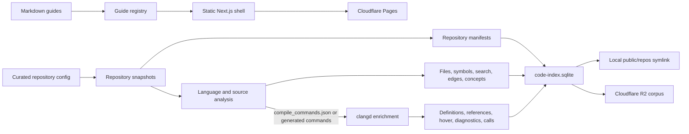
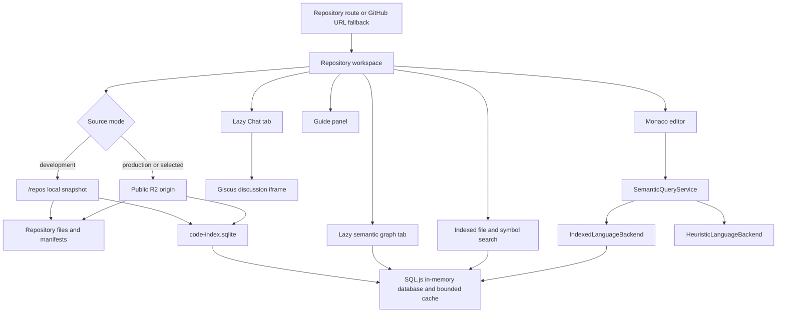
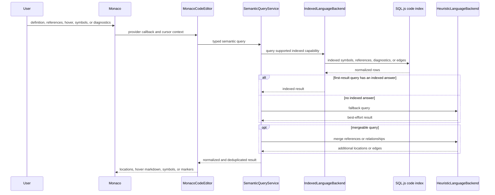

# [gitshaman.com](https://gitshaman.com)

[](https://discord.gg/fuXYz44tSs)

[](https://news.ycombinator.com/item?id=46066280)

GitShaman is a static-first Next.js source browser. It combines curated guides, a VS Code-like
workspace, indexed search, Monaco navigation, semantic graphs, and repository-scoped discussions.

## Local development

```bash
npm install
npm run dev # http://localhost:3000
```

Development prepares the SQL.js runtime and exposes the local corpus under `public/repos`. Guides
live in `docs/`; start a new guide with `docs/_template.md`. See `CONTRIBUTING.md` for the guide
workflow.

## Testing

Run all checks with one command:

```bash
npm test
```

The command runs Node tests followed by Playwright in Chromium, Firefox, and mobile Chromium.
Playwright loads `.env.local` with Next.js environment loading, prepares local assets, and starts a
development server automatically. Browser test reports and failure artifacts are written under `out/`.

The optional Giscus integration test runs when `NEXT_PUBLIC_GISCUS_REPO_ID` is set. Set the related
public Giscus variables in `.env.local`; see `docs/giscus-chat-integration.md`.

## Build and deployment

`npm run build` generates the guide registry, refreshes an out-of-date local corpus when needed,
validates guides, stages shell assets, runs the static Next.js export, and writes a build report.

Cloudflare Pages sets `CF_PAGES=1`, which skips local corpus generation and publishes the static
shell. The deployed shell reads curated snapshots and indexes from the configured public R2 origin.
Set `EXPLORAR_SKIP_CORPUS_BUILD=0` to force corpus generation in that environment.

```bash
# Refresh cached repository snapshots without compiler enrichment.
npm run corpus:sync

# Prepare compilation databases for semantic enrichment.
npm run corpus:semantic

# Check cached SQLite indexes.
npm run corpus:check

# Build and deploy the shell plus corpus artifacts.
npm run deploy
```

Local corpus indexing requires Node.js 22.22.2 or newer because it uses native `better-sqlite3`.

Cloudflare Pages serves exported routes and assets before its `404.html` fallback. Unknown GitHub
repository URLs reach the client app through `?github_path=...`. Do not add catch-all
`/:owner/:repo` rewrites: they also capture Next.js route-data files and images. After changing
routing, purge cached redirects and verify in a fresh browser context.

To use the URL-hacking workflow, replace `github.com` with `gitshaman.com` in a repository URL.

## Architecture

GitShaman does expensive source analysis before deployment. Visitors download prebuilt snapshots and
SQLite indexes; the application does not launch a language server for each session.

### Build and corpus pipeline



The index schema currently supports files, symbols, references, file relationships, guide links,
concepts, diagnostics, capability records, and full-text search. `code-index.sqlite` is versioned;
the browser accepts compatible versions and falls back gracefully when an index is unavailable.

### Browser workspace



The workspace can switch curated content between local staged files and a configured R2 origin while
developing. In production, it uses the public R2 origin. The code-index cache is keyed by repository,
revision, and source mode so local and remote artifacts do not overlap.

The Guide/Chat sidebar mounts the Giscus widget only after Chat is selected. Each repository uses a
specific discussion term (`gitshaman:repo:<owner>/<repo>`). When Giscus is not configured, the UI
shows setup guidance instead of loading an iframe.

### Semantic query flow



`SemanticQueryService` orders registered backends by capability and priority, isolates provider
failures, and exposes a shared query contract. Definitions, hover, and document symbols use the first
useful result. References and relationships merge and deduplicate provider results. Type members and
include chains require indexed data; diagnostics are available when the loaded index supports them.

The indexed backend supports C, C++, Python, TypeScript, and JavaScript. Compiler-backed enrichment
currently targets C-family repositories. Other languages continue to use indexed structural data and
heuristic navigation where compiler data is unavailable.

### Semantic graph

The Semantic Graph tab loads only when selected. It reads bounded relationship data from the SQLite
index during idle time, classifies edges as calls, data flow, dependencies, or other relationships,
and renders them with provider and confidence metadata. This keeps large indexes out of the critical
workspace path.

## Current scope and boundaries

- C and C++ have the first compiler-backed enrichment path through `clangd`.
- Generated source-only compilation commands are explicitly partial; native compilation databases in
  `build/` or `out/` take precedence.
- Data-flow relationships are intraprocedural and best effort, not alias, interprocedural, or taint
  analysis.
- Repositories without a usable index continue with source browsing and heuristic editor behavior.
- The semantic graph and Giscus chat are lazy features, so neither blocks initial workspace loading.
