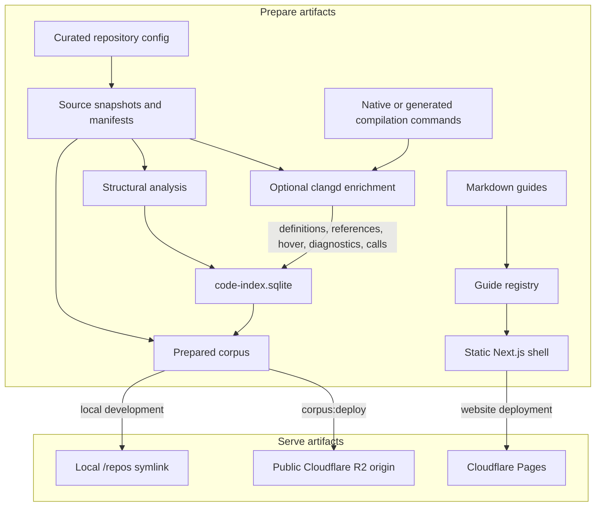
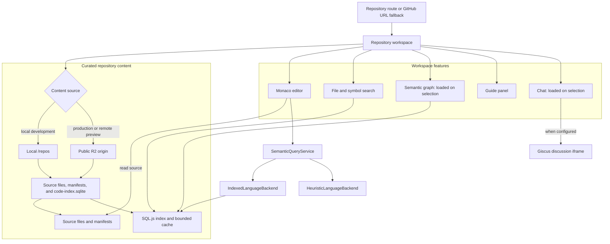
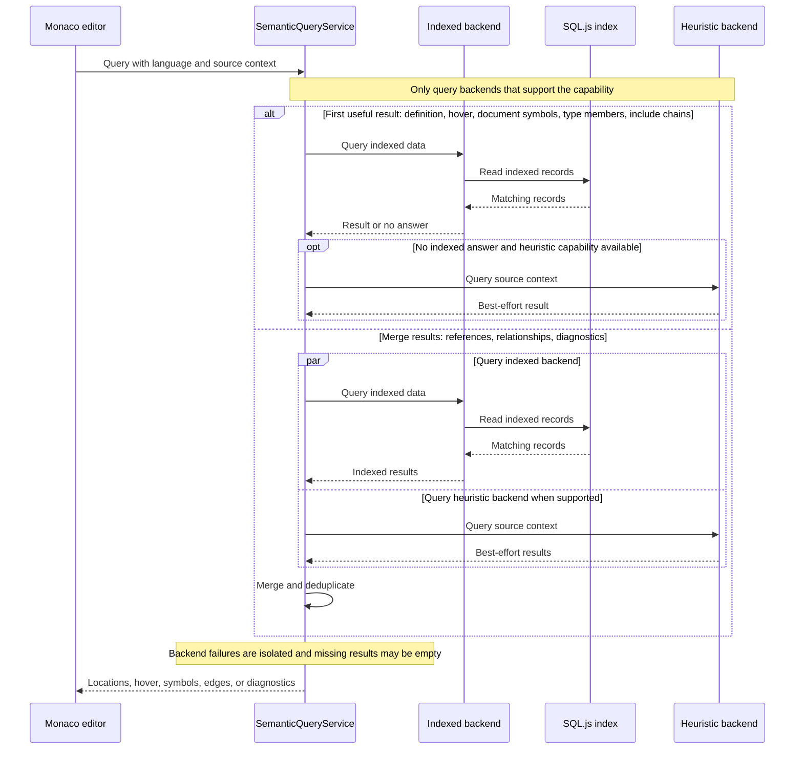

# [gitshaman.com](https://gitshaman.com)

[](https://discord.gg/fuXYz44tSs)

[](https://news.ycombinator.com/item?id=46066280)

GitShaman is a static-first Next.js source browser. It combines curated guides, a VS Code-like
workspace, indexed search, Monaco navigation, semantic graphs, and repository-scoped discussions.
The GitShaman CLI brings source analysis and a local browser workspace to your own Git repositories.

## CLI

Requires Git, Node.js 22.22.2 or newer, and npm 9 or newer. Build the CLI from this checkout:

```bash
npm install
npm run cli:build
node packages/cli/dist/cli.js --help

# Initialize and analyze a Git worktree, then open its local workspace.
node packages/cli/dist/cli.js init --repo /path/to/repository
node packages/cli/dist/cli.js analyze --repo /path/to/repository --no-embed
node packages/cli/dist/cli.js viz --repo /path/to/repository
```

To make the `gitshaman` command available, run `npm link ./packages/cli` from this checkout.
The examples below use that command inside the target repository. For CLI development, use
`npm run cli -- <command> --repo /path/to/repository`; build first so `viz` and `verify` have
their packaged assets.

`init` creates `gitshaman.json` and `.gitshamanignore`, and adds `.gitshaman/` to `.gitignore`.
Configuration and extra ignore patterns can be committed; generated indexes and caches live in
`.gitshaman/`. Configure analysis exclusions, language filters, and enrichment in `gitshaman.json`.
The generated configuration starts with:

```json
{
  "version": 1,
  "analysis": {
    "exclude": [],
    "languages": [],
    "enrichment": "auto"
  },
  "embeddings": {
    "provider": "ollama",
    "model": "embeddinggemma",
    "endpoint": "http://127.0.0.1:11434"
  }
}
```

An empty `languages` list includes all detected languages. Use identifiers such as `c`, `cpp`,
`python`, `typescript`, or `javascript` to restrict analysis. Add Git-style ignore patterns to
`analysis.exclude` or `.gitshamanignore`; set `analysis.enrichment` to `off` to disable compiler
enrichment.

| Command                   | Purpose                                                                              |
| ------------------------- | ------------------------------------------------------------------------------------ |
| `gitshaman init`          | Initialize the current Git worktree.                                                 |
| `gitshaman analyze`       | Build source indexes and attempt embeddings.                                         |
| `gitshaman viz`           | Serve the local source workspace and graph, and open a browser.                      |
| `gitshaman parser [path]` | Inspect heuristic symbols and structure for a repository-relative file or directory. |
| `gitshaman embed`         | Refresh embeddings for the current analysis.                                         |
| `gitshaman version`       | Show CLI, index, and compiler component versions.                                    |
| `gitshaman verify`        | Check packaged assets, SQLite indexes, and embedding compatibility.                  |
| `gitshaman checksum`      | Refresh observed source checksums.                                                   |
| `gitshaman share`         | Contribute a public commit to the curated collection through a GitHub PR.            |

All commands accept `--repo <directory>` and `--help`; `--json` is also available. Analysis reads the working tree
by default; use `--committed` to analyze `HEAD`, `--no-embed` to skip embeddings, or `--force`
to rebuild. Run `analyze` again after source changes. `viz` binds to `127.0.0.1` on an available
port; use `--port 3001` to select a port or `--no-open` to print the URL without opening a browser.
The local viz uses the same repository interface as gitshaman.com: editor, indexed file search,
entities, guides, themes, and status bar. Files and indexes load from the authenticated local
server. Public discussions and source-file link sharing are unavailable for local repositories.
Stop the server with Ctrl+C. MCP support is deferred.

### Embeddings

`gitshaman embed` converts chunks of the analyzed source code into embeddings: lists of numbers
that represent the code's meaning. These vectors enable semantic search, so a query such as
"where are failed connections retried?" can find relevant code even when it uses different words.
The command stores generated vectors in `.gitshaman/` without modifying your source files.

`gitshaman analyze` already attempts to generate embeddings. Run `gitshaman embed` separately
to refresh embeddings for the current analysis, or to generate them after an analysis that skipped
this step. After changing source files, run `gitshaman analyze` again first; `embed` uses the
existing analysis rather than reanalyzing the source.

The default provider is Ollama at `http://127.0.0.1:11434`, using the `embeddinggemma` model.
With Ollama running locally, source chunks are processed on your machine. Install the model and
embed the analyzed source:

```bash
ollama pull embeddinggemma
gitshaman embed
```

If Ollama is unavailable, `analyze` still produces structural indexes and reports skipped
embeddings. Use `--no-embed` for structural analysis without provider requests. To use OpenRouter,
set `embeddings.provider` to `openrouter`, configure `endpoint` and `model`, and set `apiKeyEnv`
to the name of an environment variable containing the API key. With OpenRouter configured,
source chunks are sent to that provider when embeddings run. Keep credentials in the environment.
Embedding-based search also sends the search query to the configured provider to generate its vector.

### Share a public repository

Sharing requires analysis of the current committed snapshot and a commit already accessible in
a public GitHub repository. Install the GitHub CLI and run `gh auth login` before submitting:

```bash
gitshaman analyze --committed --no-embed
gitshaman share --dry-run
gitshaman share
```

`--dry-run` validates the public source and prints the proposed contribution without creating a PR.
Use `--source owner/repo` to override remote detection, `--name`, `--description`, and `--slug`
to customize metadata, or `--guide path/to/guide.md` to include a validated guide. `--no-open`
suppresses opening the result in a browser. Sharing contributes a reproducible recipe and summary;
local vectors and credentials are not included. After review and merge, GitShaman rebuilds and
publishes the curated corpus. The [community workflow](.github/workflows/community.yml) validates
contributions on pull requests, rebuilds pinned sources after merge to `main`, and publishes through
the `community-publication` environment. Publication requires configured R2 credentials and a
Cloudflare Pages deploy hook.

## Local development

```bash
npm install
npm run dev # http://localhost:3000
```

Development prepares the SQL.js runtime and exposes the local corpus under `public/repos`.
Run `npm run corpus:sync` to populate or refresh local curated snapshots. This corpus is separate
from the `.gitshaman/` analysis created by the CLI in a target repository.

See [.env.example](.env.example) for public content-origin and Giscus settings; put local overrides
in `.env.local`. Guides live in `docs/`; start a new guide with
[docs/_template.md](docs/_template.md). Run `npm run guides` to validate the guide registry, prose,
and repository references. See [CONTRIBUTING.md](CONTRIBUTING.md) for the guide format.

### Android platform snapshots

LineageOS and GrapheneOS have manifest-backed workspaces. `npm run corpus:sync` builds
both their manifest repositories and the configured core platform projects. To rebuild only
Android workspaces after their manifests are present, run `npm run corpus:android`.
Use `-- --only=LineageOS/android` or `-- --only=GrapheneOS/platform_manifest` to select one.

Project commits are recorded in `src/curated/android-locks/` and reused on later builds.
Update those commits deliberately with `npm run corpus:android -- --refresh`, review the
lockfile changes, and run `npm run corpus:check` before release. Each completed workspace
has immutable source and project-index artifacts under its manifest revision's
`android/snapshots/` directory. The corpus deployment uploads and verifies those artifacts
before publishing `android/workspace.json`; running the build does not deploy anything.

The browser opens the Android source tree by default and exposes the manifest as a separate
view. Search covers the listed core projects, with optional project scoping. Files larger than
2 MiB, binary files, and filesystem symlinks are excluded; manifest copy/link mappings are
resolved within the hosted source. Indexed content is limited to 64 KiB per file and references
are text occurrences. Java, Kotlin, and AIDL type definitions use text heuristics rather than compiler bindings. The initial selection excludes device trees, kernels, and prebuilts.

## Testing

Install the Playwright browsers once before running browser tests:

```bash
npx playwright install chromium firefox
```

Run the Node and browser test suites:

```bash
npm test
```

The command runs Node tests followed by Playwright in Chromium, Firefox, and mobile Chromium.
Its preparation step builds the CLI and bundled workspace. To run only CLI checks, use
`npm run test:cli`, which builds the package and runs CLI Node and workspace browser tests.
This includes command subprocesses, analysis and retrieval, failure cleanup,
and the shared workspace UI. Run `npm run test:cli:coverage` for source-level CLI line, branch, and
function coverage from the Node suites; browser tests run separately under `test:cli`.
Playwright loads `.env.local` with Next.js environment loading, prepares local assets, and starts a
development server automatically. Browser test reports and failure artifacts are written under `out/`.

Run `npm run lint` separately for type, ESLint, formatting, guide prose, and Markdown checks.

The optional Giscus integration test runs when `NEXT_PUBLIC_GISCUS_REPO_ID` is set. Set the related
public Giscus variables in `.env.local`; see
[docs/giscus-chat-integration.md](docs/giscus-chat-integration.md).

## Build and deployment

`npm run build` generates the guide registry, refreshes an out-of-date local corpus when needed,
validates guides, stages shell assets, runs the static Next.js export, and writes a build report.

Cloudflare Pages sets `CF_PAGES=1`, which skips local corpus generation and publishes the static
shell. The deployed shell reads curated snapshots and indexes from the configured public R2 origin
(`NEXT_PUBLIC_R2_PUBLIC_BASE_URL`; see [.env.example](.env.example)).
Set `EXPLORAR_SKIP_CORPUS_BUILD=0` to force corpus generation in that environment.

```bash
# Refresh cached repository snapshots without compiler enrichment.
npm run corpus:sync

# Prepare compilation databases for semantic enrichment.
npm run corpus:semantic

# Check cached SQLite indexes.
npm run corpus:check

# Upload changed/missing files from the prepared local corpus to R2.
npm run corpus:deploy
```

Cloudflare Pages publishes the website shell separately. `corpus:deploy` uploads only the current
curated repository revisions, using content hashes rather than timestamps or file sizes.
It lists each current remote prefix on every run to repair missing objects, but uploads only
the diff. Unchanged runs perform no uploads, including deployment metadata. Missing metadata is
recreated without re-uploading matching single-part objects. Old revisions remain untouched.
Local hashes are cached under `.cache/r2-deploy`;
the first run reads every local file, while later runs reuse hashes when file metadata matches.
Set `R2_DEPLOY_VERIFY=1` to force rehashing. Remote multipart objects without a recorded content
hash may need a one-time upload to establish an inventory. Per-repository logs report scan,
upload, verification times, and skipped/uploaded file counts. `R2_SYNC_CONCURRENCY` controls
concurrent repositories (default 2); AWS CLI transfer settings control each upload pool.

Local corpus indexing requires Node.js 22.22.2 or newer because it uses native `better-sqlite3`.

Cloudflare Pages serves exported routes and assets before its `404.html` fallback. Unknown GitHub
repository URLs reach the client app through `?github_path=...`. Do not add catch-all
`/:owner/:repo` rewrites: they also capture Next.js route-data files and images. After changing
routing, purge cached redirects and verify in a fresh browser context.

To use the URL-hacking workflow, replace `github.com` with `gitshaman.com` in a repository URL.

## Architecture

For curated repositories, GitShaman does expensive source analysis before deployment. Visitors download prebuilt snapshots and
SQLite indexes; the application does not launch a language server for each session.

### Build and corpus pipeline



The index schema currently supports files, symbols, references, file relationships, guide links,
concepts, diagnostics, capability records, and full-text search. `code-index.sqlite` is versioned;
the browser accepts compatible versions and falls back gracefully when an index is unavailable.

### Browser workspace



The workspace can switch curated content between local staged files and a configured R2 origin while
developing. In production, it uses the public R2 origin. The code-index cache is keyed by repository,
revision, and source mode so local and remote artifacts do not overlap.

The Guide/Chat sidebar mounts the Giscus widget only after Chat is selected. Each repository uses a
specific discussion term (`gitshaman:repo:<owner>/<repo>`). When Giscus is not configured, the UI
shows setup guidance instead of loading an iframe.

### Semantic query flow



`SemanticQueryService` orders registered backends by capability and priority, isolates provider
failures, and exposes a shared query contract. Definitions, hover, and document symbols use the first
useful result. References, relationships, and diagnostics merge and deduplicate provider results.
Type members and include chains require indexed data; diagnostics are available when the loaded index supports them.

The indexed backend supports C, C++, Python, TypeScript, and JavaScript. Compiler-backed enrichment
currently targets C-family repositories. Other languages continue to use indexed structural data and
heuristic navigation where compiler data is unavailable.

### Semantic graph

The Semantic Graph tab loads only when selected. It reads bounded relationship data from the SQLite
index during idle time, classifies edges as calls, data flow, dependencies, or other relationships,
and renders them with provider and confidence metadata. This keeps large indexes out of the critical
workspace path.

## Current scope and boundaries

- C and C++ have the first compiler-backed enrichment path through `clangd`.
- Generated source-only compilation commands are explicitly partial; native compilation databases in
  `build/` or `out/` take precedence.
- Data-flow relationships are intraprocedural and best effort, not alias, interprocedural, or taint
  analysis.
- Repositories without a usable index continue with source browsing and heuristic editor behavior.
- The semantic graph and Giscus chat are lazy features, so neither blocks initial workspace loading.
